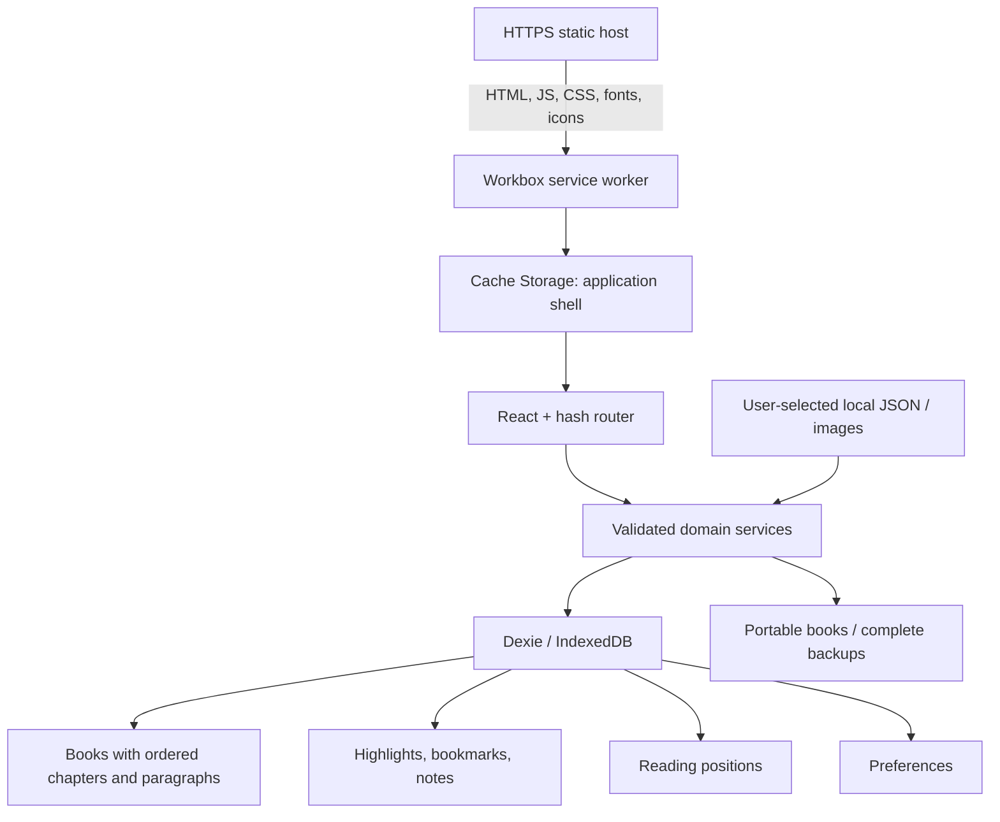

# Architecture

Chapterlet has no application server. Static hosting distributes application code. The browser owns all reading data.

## Boundaries

- **React** renders semantic UI and owns DOM updates. Local UI state holds transient filters, dialogs, and selections. No Redux or global application-data store is needed.
- **Repositories** own database writes, duplicate decisions, cascade deletion, and transactions. Components call services rather than coordinating tables themselves.
- **Dexie** provides typed tables and reactive queries. Books contain ordered nested chapter/paragraph arrays; this keeps a content import atomic and straightforward for short books. Annotations and progress reference immutable IDs.
- **Zod** validates public content and internal backup structures. The public schema deliberately excludes IDs. The backup schema verifies unique identifiers and references before any mutation.
- **Workbox** precaches application resources. It never reads or uploads IndexedDB. Cache Storage is replaceable code; IndexedDB is irreplaceable personal data unless backed up.
- **Manifest** declares identity, icons, standalone display, start URL, and scope. It does not store books or itself guarantee offline capability.
- **React Router (`createHashRouter`)** uses client-side fragments so static hosts do not need deep-route rewrites. `BASE_PATH` controls assets and PWA scope.

## Tables and versions

`books`: primary key `id`; indexes `addedAt`, `duplicateKey`. Each book has metadata plus ordered chapters, each with ordered paragraphs and their generated IDs. Embedded covers are validated data URLs in this record. Keeping them in the same record makes book export and backup self-contained; at the 3 MB cover cap this trades some base64 overhead for a simpler schema.

`annotations`: primary key `id`; indexes `bookId`, `chapterId`, `kind`, `createdAt`. A note is either its own chapter/passage annotation or an optional plain-text note on a highlight/bookmark. All personal annotations are separate from book content.

`progress`: primary key `bookId`; index `updatedAt`. References a chapter and paragraph and stores a derived percentage. The most recently updated record identifies the last-read book and drives the library’s default sort.

`preferences`: singleton `id: "reader"`, persisted in IndexedDB. System light/dark preference determines the initial default only until a preference is stored.

Database version 1 defines the tables. Version 2 adds the duplicate-key index and explicitly backfills normalised title/author keys without replacing IDs. A migration test opens a real version-1 fake-IndexedDB database and checks upgrade results. Future schema changes should add new versions rather than editing an old migration.

## Atomicity and recovery

Import validates data, checks duplicates, and adds a complete book in one transaction. Delete removes the book, all annotations, and its progress in one transaction. Restore validates the whole file and then writes all tables transactionally. Validation errors never partially replace a library.

IndexedDB failures are surfaced. Quota errors explain how to recover; unavailable/blocked storage gives an actionable screen. No server fallback or silent localStorage emulation exists. A persistent-storage request is always browser-controlled and never advertised as a guarantee.
